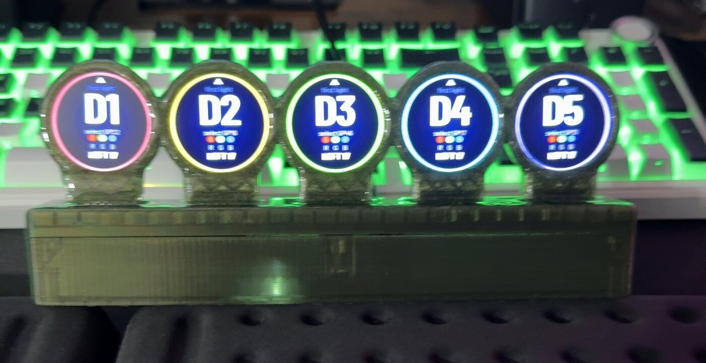
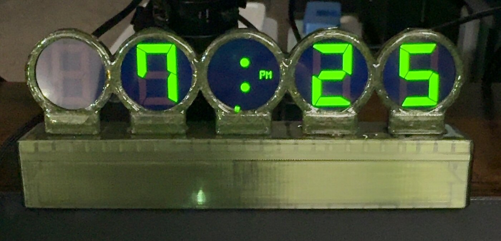
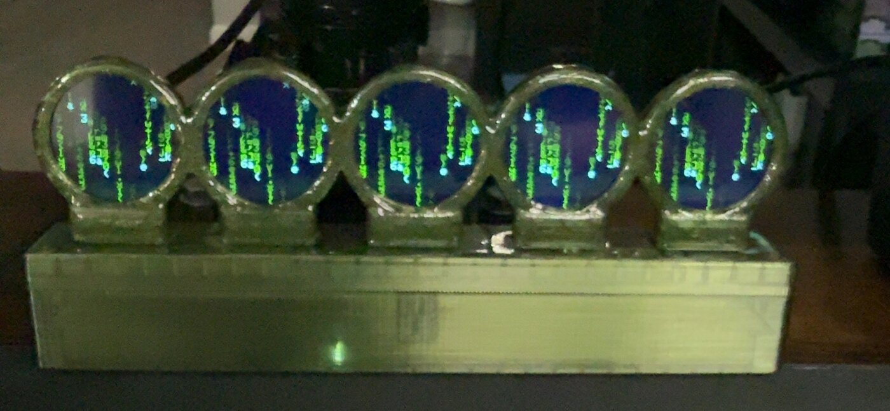

# Info Orbs XL

New brains for the [brett.tech Info Orbs](https://github.com/brettdottech/info-orbs) desk display: the ESP32 board
comes out of its socket, and a **Pimoroni Pico LiPo 2 XL W** (RP2350B, 8 MB PSRAM, Wi-Fi) goes in on a small
hand-soldered adapter. The orbs' own board, five round screens, three buttons and case stay. A 3 mm deeper base gives
the XL room. New firmware, written for the XL, draws everything itself, and a PC can feed it pictures over the USB
cable.

This repository holds everything built so far, so someone else can build one, or pick the project up and design a
proper circuit board that replaces the adapter. **If you are here to design that board, start with
[HANDOFF.md](HANDOFF.md).**

| | |
|---|---|
|  |  |
| The Clock, drawn with the original firmware's own code | The Matrix rain on all five orbs |

## What's here

| Folder | What it is |
|---|---|
| [`hardware/`](hardware/README.md) | The adapter: how it's wired, the printed step-by-step build guide (PDF), every drawing, the photos of the first build, what went wrong the first time, the deeper base (STL + Bambu Studio project), every caliper reading and board fact we took, and the original boards' part positions |
| [`firmware/`](firmware/README.md) | The XL firmware (C/C++, Raspberry Pi Pico SDK), its settings web page, the PC tool `orbs_xl.py` (Wi-Fi, weather key, loading firmware), tests |
| [`photos/`](photos/) | Photos of the original board, the XL and the adapter build, and the finished orbs |
| [`HANDOFF.md`](HANDOFF.md) | For whoever designs the replacement circuit board next: goals, constraints, decisions made, open questions |
| [`THIRD_PARTY.md`](THIRD_PARTY.md) | Every piece of other people's work in here and its licence |

## What works (on the one unit built so far)

- **On its own, over Wi-Fi:** Clock (normal or Nixie tubes), Weather, Hourly forecast, Sky (sunrise, sunset, moon,
  UV, air quality), Matrix rain, and your own Messages and countdowns. Weather comes from OpenWeatherMap.
- **A settings page** in any browser on the home network: every setting, sets on or off and in which order,
  per-set brightness and button actions, time rules, presets, a backup file, and buttons that press the orbs' buttons.
- **A setup hotspot:** when the orbs can't join Wi-Fi they open their own network, "Info Orbs Setup", and show its
  password and a QR code on the screens. Join it with a phone to choose your Wi-Fi.
- **From a PC over USB:** pictures for up to 16 more sets (system stats with live gauges, music, cameras, a
  visualizer and others). The PC program that draws those is tied to our own home setup and is **not in this
  repository**; the USB messages it uses are written down in `firmware/src/rig.h`, `pics.h` and `live.h`.
- **Cameras straight from a [Frigate](https://frigate.video/) recorder** when the PC isn't there (optional).

## What hasn't been tested (said plainly)

- Only one unit has been built, on an orbs board printed **"info orbs v0.2"**. Version 0.3 boards power the screens
  differently: the adapter as drawn would leave their screens without power. See `hardware/README.md`.
- Setting up a brand-new XL from nothing, the way a new owner would (hotspot first, then the weather key), has not been
  run start to finish.
- This public copy differs from the firmware on our unit in two things: camera names are generic (`cam1` ... `cam7`)
  and the default weather location is New York City. It compiles, its PC tests and its settings-page test pass
  (387 controls at phone and PC size); it hasn't been loaded onto an XL.
- The orbs' power draw has not been measured.

## Licence

The firmware reuses code from the original Info Orbs firmware (the clock, weather, matrix and screen drawing code, its
fonts and pictures), which is licensed under the **GNU AGPL v3**, so this whole repository is under the AGPL v3 too
([LICENSE](LICENSE)). Third-party libraries, fonts and the case model keep their own licences: see
[THIRD_PARTY.md](THIRD_PARTY.md). The deeper base is a remix of Skeetz1230's
["Info Orbs enclosure"](https://www.printables.com/model/1016115-info-orbs-enclosure) (CC BY 4.0).

Portions of this software are copyright © 1996-2013 The FreeType Project (www.freetype.org). All rights reserved.
