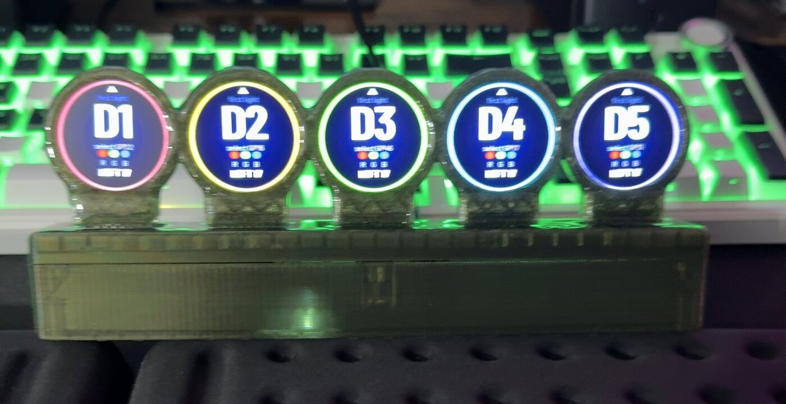
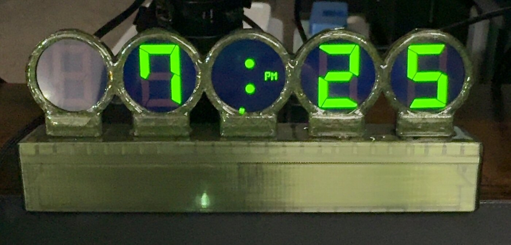
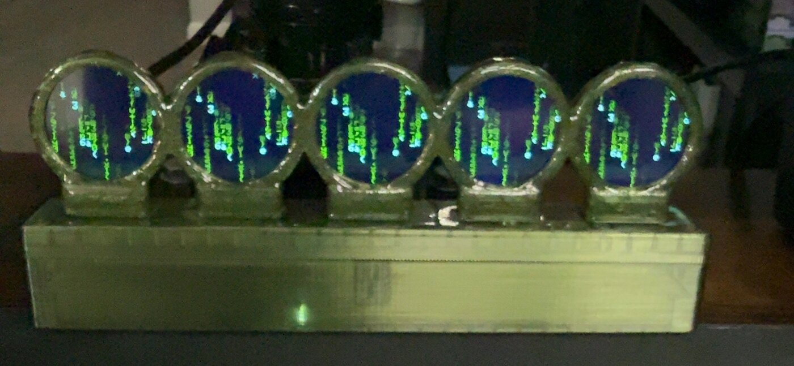
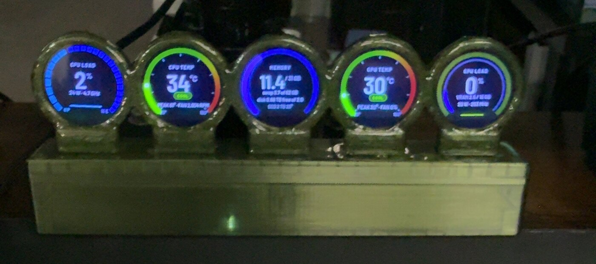

# Info Orbs XL firmware

Firmware for Info Orbs whose ESP32 has been replaced by a Pimoroni Pico LiPo 2 XL W on the adapter in `../hardware`.
C and C++ on the Raspberry Pi Pico SDK. Both of the RP2350's cores are used, every orb's picture is kept in the XL's
8 MB PSRAM, and the screens are fed by DMA.

| | |
|---|---|
|  |  |
| First light: each screen shows its own name, proving the wiring | The Clock: the original firmware's own drawing code, line for line |
|  |  |
| The Matrix rain | System stats with live gauges: drawn by a PC program over USB (not in this repository) |

## What it shows

Sets of five faces; the left and right buttons step through them.

- **The XL's own sets (Wi-Fi, no PC needed):** Clock (normal digits or Nixie tubes), Weather (now and the next
  days), Hourly (the next five hours), Sky (sunrise, sunset, moon, UV index, air quality), Matrix (the original's
  digital rain on all five orbs) and Messages (up to 8 of your own messages or countdowns).
- **Sets a PC sends over the USB cable:** up to 16 (system stats, music, cameras, a visualizer and others). Each
  shows only while a PC program talks to the orbs; after 3 s without it they leave the rotation by themselves. That
  program is tied to our own home setup and isn't included. What it sends is written at the top of `src/rig.h`
  (status, pictures, visualizer levels), `src/pics.h` and `src/live.h` (live faces: the PC sends a face's still parts
  once and then only the moving values, about 40 times a second).
- **Cameras from a Frigate recorder (optional):** when no PC is there, the Cameras set can fetch each camera's
  newest picture straight from [Frigate](https://frigate.video/) over HTTPS (see "Frigate" below).

**Buttons:** left = previous set, right = next set, middle = the set's own action (for example the clock style).
**Hold the middle button 2 s** for a QR code of the settings page's address. Every button's short, medium and long
press can be changed per set on the settings page.

## The settings page

Open the orbs' address in any browser on the same Wi-Fi (hold the middle button for the QR code; the orbs call
themselves `info-orbs` to the router). Tabs: **Now** (what each orb shows, press the buttons from the page, brightness),
**Sets** (on/off, order, cycle time, per-set brightness, colours, faces, gauge styles, button actions), **Rules**
(show a set at certain times or after an event), **Messages**, **Clock**, **Weather** (find your place by name),
**Matrix**, **Rig** (the PC sets' options), **Screens** (brightness, night mode, rotation, per-orb colour trim, the
screen link speed), **System** (units, date format, presets, a backup file to download and restore, defaults,
restart). "Try first" lets you try changes and put them back.

The page never shows or accepts the Wi-Fi password, the weather key or a camera login, and it has **no login**:
anyone on your home network can change the orbs' settings or press their buttons from it.

## First setup

1. **Load the firmware.** For the very first time the case has to be open: hold the XL's **BOOT** button while
   plugging its USB in, and copy `build/orbs_xl.uf2` onto the drive that appears. After that, with the firmware
   running, `python3 -I tools/orbs_xl.py load` reloads it over the cable (needs `picotool`).
2. **Wi-Fi.** When the orbs can't join a network they open their own, **"Info Orbs Setup"**, and show its password
   and a QR code on the screens. Join it with a phone, open the page it offers (http://192.168.4.1/) and pick your
   Wi-Fi. Or, from a Linux PC over USB: `python3 -I tools/orbs_xl.py wifi`.
3. **Weather key** (once, over USB from a Linux PC): `python3 -I tools/orbs_xl.py key`. It asks for an
   [OpenWeatherMap](https://openweathermap.org/api/one-call-3) key with the **One Call 3.0** subscription (OpenWeatherMap
   asks for a payment card for it; the first 1,000 calls a day are free; the orbs ask about every 10 minutes, plus the
   air quality and place searches).
4. **Your place:** on the settings page, Weather tab, search for your town. Until then the weather is New York City's.
   Time zone: Clock tab.

Not tested from a wiped XL by a new owner, start to finish (see the top README).

## Building

```
PICO_SDK_PATH=/path/to/pico-sdk ./build.sh
```
Needs the Raspberry Pi Pico SDK (built with 2.3.1), CMake, Ninja, Python 3 and the Arm GNU toolchain (15.2.rel1;
`PICO_TOOLCHAIN_PATH` if it isn't on your PATH). Writes `build/orbs_xl.uf2` and `build/orbs_xl.version` (the build's
name: year and month, then the minute of the month it was built). `tools/embed.py` (run by `build.sh`) turns the fonts
and pictures in `assets/` and the pages in `web/` into `src/assets.c`.

The XL runs at **250 MHz** (rated 150) with its core at 1.20 V; flash, PSRAM and the Wi-Fi link stay near their
150 MHz speeds. `cmake -DORBS_OVERCLOCK=OFF` builds it for 150 MHz.

## The PC tool: `tools/orbs_xl.py` (Linux)

`hello` (the XL's status), `buttons` (watch the presses), `load [UF2]`, `wifi`, `key`, `set NAME`, `frigate HOST PORT
USER` / `frigate off`, and a few tests (`python3 -I tools/orbs_xl.py` lists them). It only talks to a USB device whose
product name is "Info Orbs XL" (this firmware's own), never another Pico; with two XLs plugged in, add `--ser SERIAL`.
Typed secrets are sent once over USB and kept only on the XL.

## Frigate (cameras with no PC)

1. Put your Frigate camera names into `CAM_IDS` in `src/settings_json.cpp` and `CAM_ID` in `src/frigate_cams.cpp`
   (the same order; 7 cameras: five on the first page, the middle button pages to the rest), rebuild, load.
2. Make a read-only viewer account in Frigate. Then `python3 -I tools/orbs_xl.py frigate 192.168.1.50 8971 viewer`
   (your address, port and user). It shows the SHA-256 fingerprint of the certificate Frigate presents and asks
   before sending anything. Compare it on the Frigate machine itself:
   `echo | openssl s_client -connect 127.0.0.1:8971 2>/dev/null | openssl x509 -noout -fingerprint -sha256`.
3. The XL then trusts exactly that certificate and no other (the date isn't checked). **Frigate makes a new
   self-signed certificate whenever its container is recreated (an update does that)**, and the camera backup stops
   until you run step 2 again. To keep it, mount a folder of your own at `/etc/letsencrypt/live/frigate` in
   Frigate's Docker Compose file, with the current `fullchain.pem` and `privkey.pem` copied into it first; Frigate
   only makes a new one when that folder is empty.

While a PC is feeding the orbs, the XL still checks the Frigate login once an hour, so a broken backup shows up on
the settings page (Now tab) before it's needed.

## Security notes

- The Wi-Fi password, the weather key and the Frigate login are kept in the XL's flash. Anyone holding the XL can read
  them out (as with the ESP32 before).
- The setup hotspot is WPA2 with a new random password shown only on the orbs, so only someone looking at them can
  join. The home Wi-Fi password can be set from the hotspot's page, never from the home network.
- HTTPS to OpenWeatherMap checks the certificate against the roots in `src/ca_roots.h` and the host name (TLS 1.2 and
  1.3, mbedTLS).
- The settings page is plain HTTP without a login, on the home network only.

## Code map

| File | What |
|---|---|
| `src/main.cpp` | Start-up, the sets and their rotation, buttons, the USB messages, the main loop |
| `src/screen.cpp`, `tft.cpp`, `clock_widget.cpp`, `weather.cpp`, `matrix_widget.h` | The original firmware's drawing code and widgets, drawn into each orb's picture in PSRAM |
| `src/sets_new.cpp` | Hourly and Sky (they replace the original's Stocks) |
| `src/lcd.c` | The five GC9A01 screens: SPI0 and DMA, the original's start-up sequence |
| `src/pics.cpp`, `live.c` | Pictures and live faces from the PC, on the second core (both cores build live faces) |
| `src/net.c`, `https.c`, `hotspot.c`, `web.cpp` | Wi-Fi, HTTPS (mbedTLS over lwIP), the setup hotspot and its small DHCP server, the settings page's server |
| `src/settings.c`, `settings_json.cpp`, `presets.c`, `camlogin.c` | Settings in flash (versioned, checksummed), as the page's JSON, presets, the Frigate login |
| `src/orbs_time.c` | Network time and time zones (POSIX TZ rules) |
| `web/` | The settings page (`index.html`), the hotspot's page (`wifi.html`), `API.md`, a stand-in server and a page test |
| `first-light/` | The first test firmware (each screen's name, the pins, colours, the buttons); not built by `CMakeLists.txt` any more, kept for testing a new board |
| `tools/` | `orbs_xl.py`, `embed.py`, the PC tests, set previews |
| `third_party/`, `assets/` | Libraries, fonts and pictures, with their licences (`../THIRD_PARTY.md`) |

## Tests (on a PC)

- `tools/test_settings.sh`: the settings' layouts, version upgrades and checksums (all pass on this copy).
- `tools/test_time.sh`: the time zone rules against the PC's own, 9.5 million times in 14 zones (all pass).
- `web/standin.py` + `node web/test_page.mjs http://127.0.0.1:8099/ OUT both`: every control on the settings page
  through its real click handler at a phone size and a PC size, with a picture after each (387 controls, 0 errors on
  this copy). Never point it at real orbs unless you mean to: it changes settings (it puts them back at the end).
- `tools/preview_sets.sh`: renders the Hourly and Sky faces to PNG on the PC.

## Measured on our unit

- USB from the PC: about 620 KB/s raw; 621 of 621 test pictures decoded in a 2-minute run.
- A full redraw of the four live system-stat faces: 261 ms on one core, 137 ms on both.
- Live faces: about 50 frames a second; camera video from the PC: about 31 pictures a second over the five orbs.
- Frigate pictures straight to the XL: 6.3-6.9 a second over the five orbs (one kept-open connection).
- The screen link: 42 MHz (Normal) or 62.5 MHz (Fast). 125 MHz was tried and taken out: it didn't help (the chip's
  decoding and drawing are the limit) and once left one orb with stripes until a restart. Normal is the default.
