# The XL adapter

The original Info Orbs run on an ESP32 DevKit (38 pins) that sits in a socket on the back of the orbs' board. The
Pimoroni Pico LiPo 2 XL W doesn't fit that socket, so it sits on a small piece of perfboard whose pins plug into the
same socket. Fifteen short links on the perfboard's underside take each signal the board uses from the ESP32's pin to
the XL's. Nothing on the orbs' board is cut or changed, and the ESP32 can go back in.

**Everything here was built and checked once, on a board printed "info orbs v0.2".** The printed guide
(`xl_build_guide.pdf`, 17 pages) is the one that build followed, with the lessons below added at the steps they
belong to.

## The original board and the parts

| | |
|---|---|
| 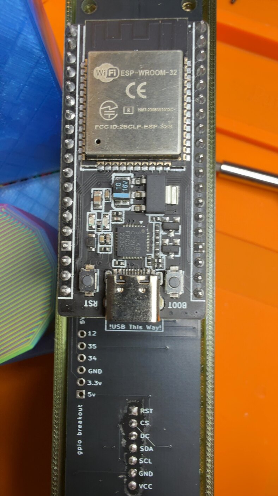 | 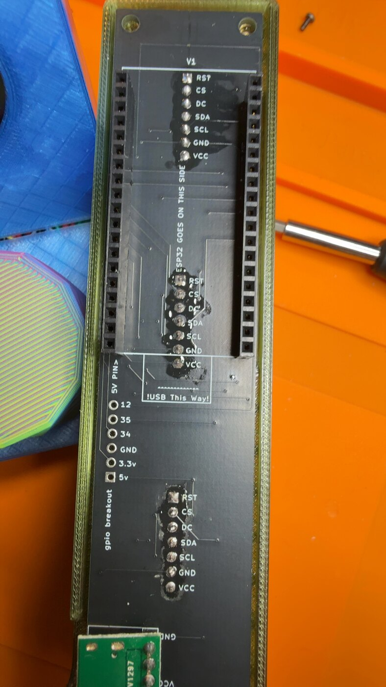 |
| The ESP32 DevKit in its socket ("!USB This Way!": its USB-C points toward the middle of the board) | The two 19-hole socket rows, the "gpio breakout" pads and the screens' signal pads |
| 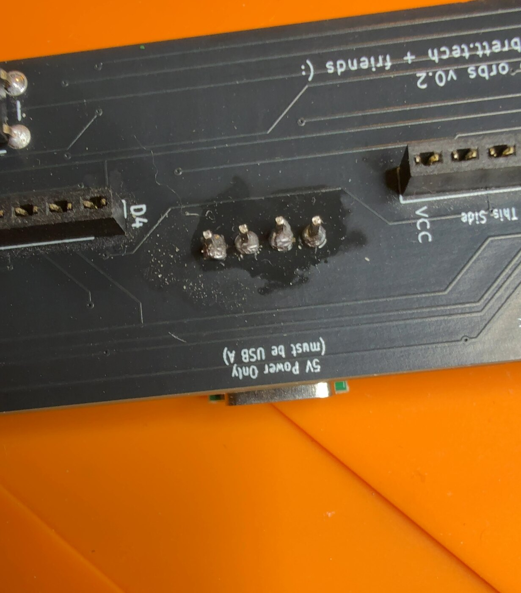 | 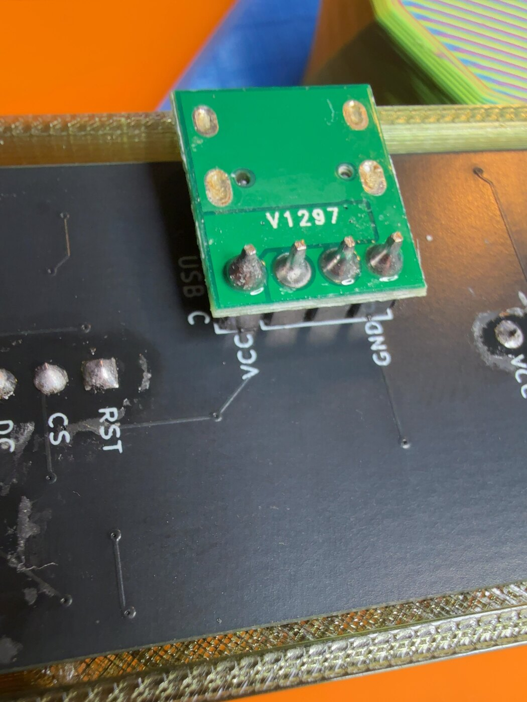 |
| "info orbs v0.2" and "5V Power Only (must be USB A)" on the board | The case USB board ("V1297"): VCC, D-, D+, GND. On the orbs board only VCC and GND are used |
| 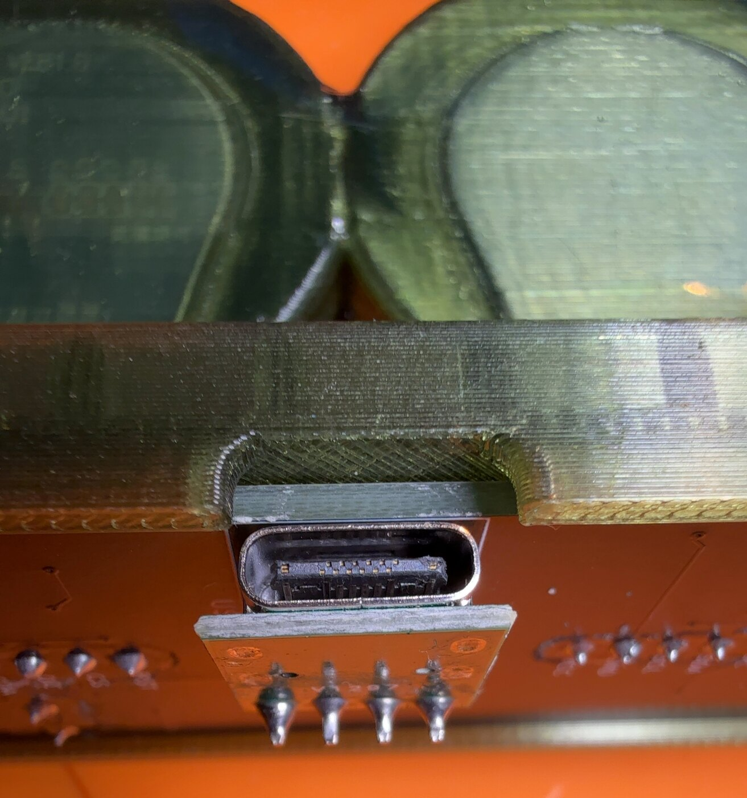 | 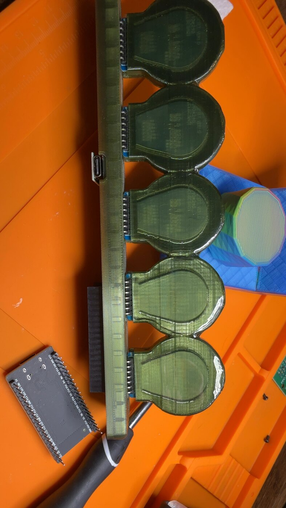 |
| The case's USB-C port | The five screens stand at right angles to the board; they stay as they are |
| 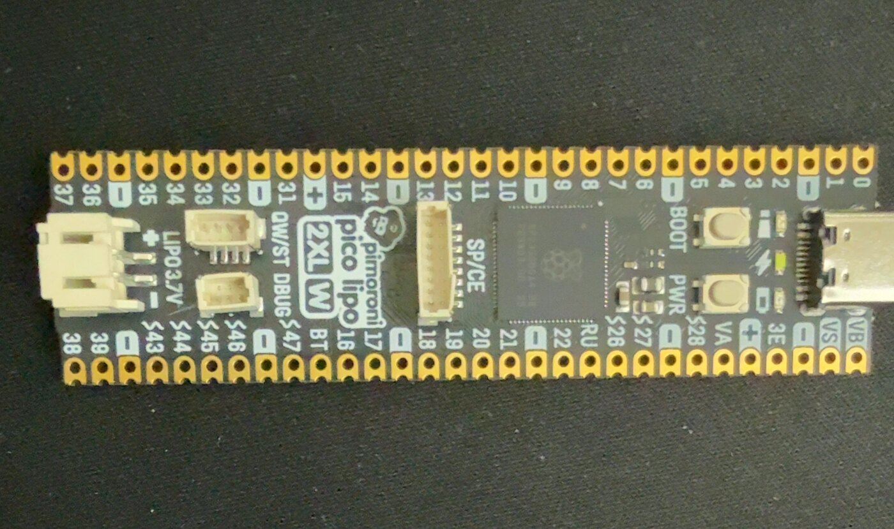 | 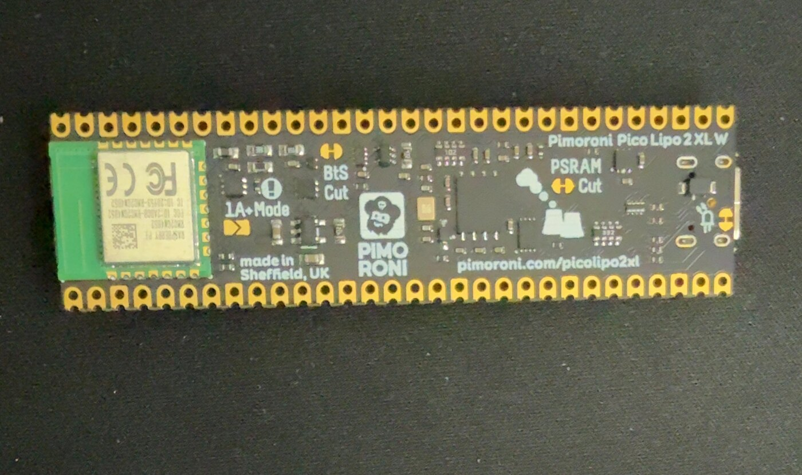 |
| Pimoroni Pico LiPo 2 XL W, top (pin names printed) | Underside: the Wi-Fi module (RM2) at the antenna end, which matters for the notch below |

## The first build

| | |
|---|---|
| 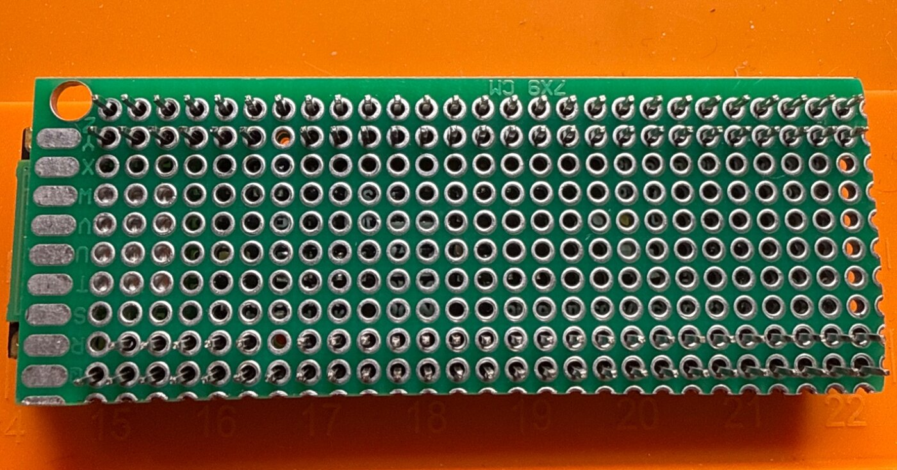 | 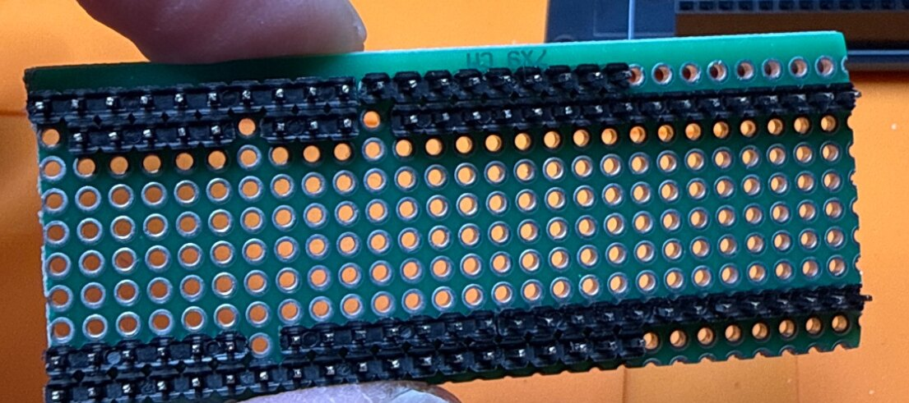 |
| A1: the perfboard cut to 10 x 27 holes | B and C: the two 19-pin socket strips on the edges, the two 27-pin XL strips inside them (gaps where pins were pulled) |
| 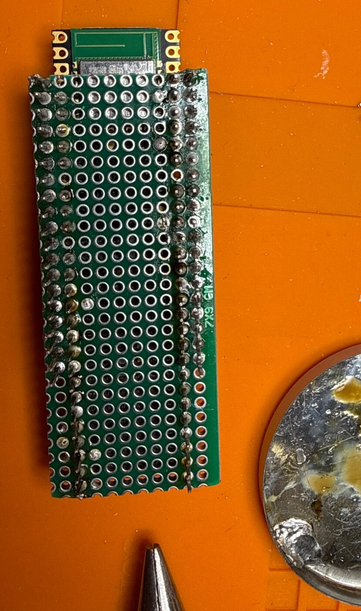 | 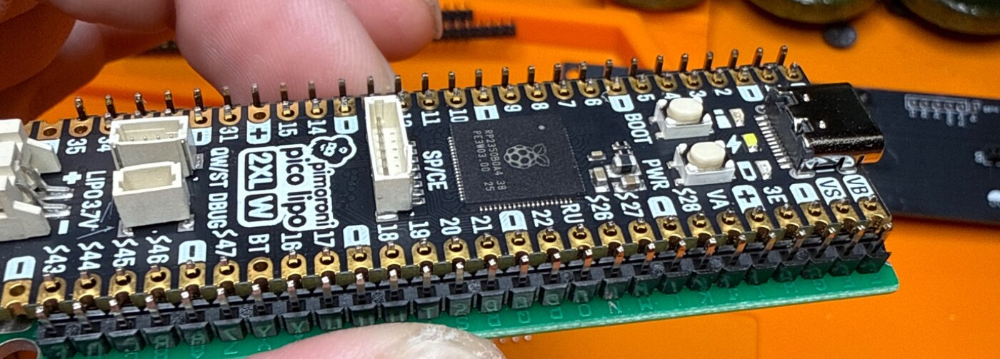 |
| The underside with the strips soldered, before the links; the XL's Wi-Fi module shows through the holes at the top, where the notch was cut | The XL resting on its strips, its USB-C at the far end |

No photo was taken of the finished underside with all 15 links; `renders/wiring_2_under.png` and the guide's part D
show it. After the build the adapter was checked with a meter (part E), powered on its own (5 V where it should be),
plugged into the orbs through the case's USB port and fed 51 MB of test pictures from a PC over USB with no errors.

## Files

| File | What it is |
|---|---|
| `xl_build_guide.pdf` (+ `.html`) | **The printed build guide**: names, supplies, each step A1-H5, one drawing per link, the meter table. Made by `make_build_guide.py` from the drawings `draw_guide.py` makes |
| `WIRING.md` | The same wiring in short text form, with the pin map for the firmware |
| `BOARD_FACTS.md` | Every caliper reading and meter check we took, the v0.2 board's connections, the v0.3 differences, the XL's facts and the fit numbers |
| `board-positions/` | Every part and pad position on the original boards (v0.2 and v0.3), read from their KiCad design files by `kicad_parts.py` |
| `renders/` | `wiring_1_top.png`, `wiring_2_under.png`, `wiring_3_side.png`, `wiring_4_usb.png` (`draw_wiring.py`); the first layout sketch `adapter_top.png` / `adapter_side.png` (`draw_adapter.py`; the buttons' resistors in it were dropped, see below); the base renders; `guide/` = the guide's drawings |
| `base_xl_3mm.stl` | The deeper base (the part the ESP32 pointed into), 3 mm deeper, made by `make_base.py` from `source/bottom_20mmscrews.stl` |
| `print_base_xl_3mm.stl` | The same, moved up onto the print bed |
| `orbs_base_xl_petg.3mf` | Bambu Studio project for it: X1 Carbon, 0.20 mm Standard, Generic PETG, Supertack plate (`make_project.py`). **Add a brim** |
| `check_fit.py`, `render_base.py`, `render_posts.py` | Fit checks and pictures of the base |
| `source/` | The original case base it starts from (Skeetz1230, CC BY 4.0) |

The scripts need Python 3 with `numpy`, `trimesh` and `matplotlib`, and `manifold3d` for `make_base.py` (its
post cut uses trimesh's manifold engine);
`make_build_guide.py` needs Google Chrome for the PDF. `make_base.py --extra 3 --plug-width 10.97` rebuilds
`base_xl_3mm.stl` byte for byte from the file in `source/` (checked).

## Before you start

- **Look at your orbs' board:** this adapter is for one printed **"info orbs v0.2"**. On v0.2 the screens and the
  buttons run on the USB 5 V. On **v0.3** the screens are powered from the ESP32's 3.3 V pin, which this adapter
  leaves unconnected, and the buttons switch 3.3 V. A v0.3 board needs a changed adapter (at least a link from the
  socket's 3V3 pin to the XL's 3.3 V output; whether the XL's 600 mA regulator can carry five screens has not been
  measured). See `BOARD_FACTS.md`.
- **The ESP32 must sit in a socket** (two 19-hole rows), not be soldered in.
- **The XL is soldered to the adapter for good.** There was no height for a socket under it (see "Choices made"
  below). The adapter as a whole still unplugs from the orbs.
- Parts: perfboard (2.54 mm, double-sided), male header strips (2 x 19 and 2 x 27 pins, pieced from shorter strips is
  fine), solid hookup wire, a USB-C cable you can cut, the XL, the deeper base (printed), the case's own 20 mm screws.
  Tools: soldering iron, flush cutters, pliers, a multimeter, a marker. About 2 hours (a guess).

## Lessons from the first build (in the guide now)

- **The edge (socket) strips go in plastic-on-top, long ends down through the board: the opposite of the usual way.**
  The first build fitted them the usual way and had to heat each joint and push the pins through.
- **The edge strips are 19 pins, not 27:** pins 20-27 would land on the orbs board past the socket (on one side right
  on the gpio breakout pads).
- **Cut a notch for the XL's Wi-Fi module:** the module on the XL's underside sits only about 0.1 mm above the
  perfboard. Cut out the middle 4 columns of the first 3 rows at the dot end (keep 3 columns each side for the links
  that run there). With the notch, no Kapton tape is needed.
- **Straighten leaning pins** before soldering anything.
- **The board's print for the case USB board's D+ and D- is swapped:** on our unit a meter found D+ on the middle pin
  next to GND. Check yours with the meter.
- **Print the base with a brim:** the first print (PETG, Supertack plate, no brim) warped.

## Choices made (and what they cost)

- **The XL soldered onto the adapter, not in a socket:** the XL's top ends up about 1.9 mm under the deeper base's
  floor. Standard female headers would add about 8.5 mm, low-profile machine-pin sockets about 3 mm (estimates, parts
  not checked), so a removable XL needs a still deeper base. The person who owns this unit would have preferred it
  removable, like the original ESP32: worth keeping in mind for a new board.
- **The buttons wired straight, no resistors:** on v0.2 a pressed button puts 5 V on its pin. The XL's chip (RP2350
  stepping A4) takes 5 V on GPIO 0-29 **while it is powered**, so GP18-20 are in spec then; a button held at the very
  moment of plugging in is briefly out of spec. The first layout had a 10k/15k divider per button (3.0 V, always in
  spec) but placing them meant wires crossing joints under the XL. A real circuit board should put the dividers back.
- **USB data through a cut cable:** the orbs board carries only USB power, and the XL's USB data pins exist only at
  its own USB-C port. A cut USB-C cable's plug goes into the XL; its D+ and D- wires are soldered onto the case USB
  board's two middle pins, and its other wires are cut back and covered.
- **The three grounds joined on the adapter:** on v0.2 the USB ground, the screens' ground and the breakout's ground
  are joined only through the ESP32. Links D14 and D15 join the first two to the XL's ground; the breakout's ground is
  left alone.
- **The XL is fed through its VB pin** from the socket's 5V pin (the case's USB 5 V), so the XL's own USB-C port only
  carries data.

## The deeper base

`make_base.py` doesn't redraw anything: it stretches the original base at one height (z -23.5 mm, where everything
the cut crosses is a straight vertical wall) by 3 mm, so the inside is 3 mm deeper (17.00 -> 20.00 mm) and the
screw-head holes 3 mm deeper. The lip, posts and screw positions are the original's, and the same 20 mm screws reach
exactly as far. The two middle posts are cut back on their inner faces so the cut cable's plug (10.97 mm wide)
passes between them (gap 12.00 mm, was 9.24). Watertight, not mirrored. `check_fit.py` with the XL in place: XL top
1.91 mm clear of the floor, the plug 2.95 mm, the perfboard 9.39 mm; sideways about 1.3 mm at the XL's end, 2.25 mm at
the perfboard, 0.53 mm at the plug.

Printed on a Bambu X1 Carbon: 0.20 mm Standard, Generic PETG, Supertack plate, 43 g, about 1 h 15 min, floor on the
bed as the original sits. The second print, with a brim, went on with its 4 screws (no fit problem reported; not
measured).

## Not tested

A second adapter; a v0.3 board; the adapter's power draw with all five screens; the guide followed by anyone but its
first builder.
